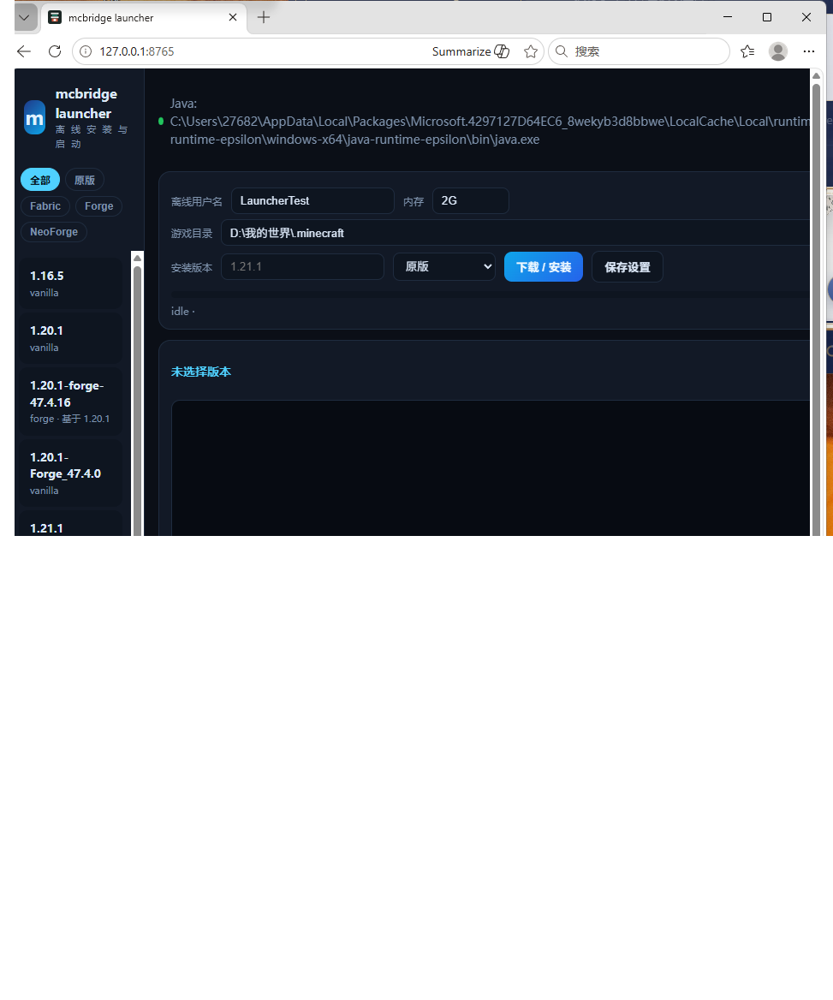
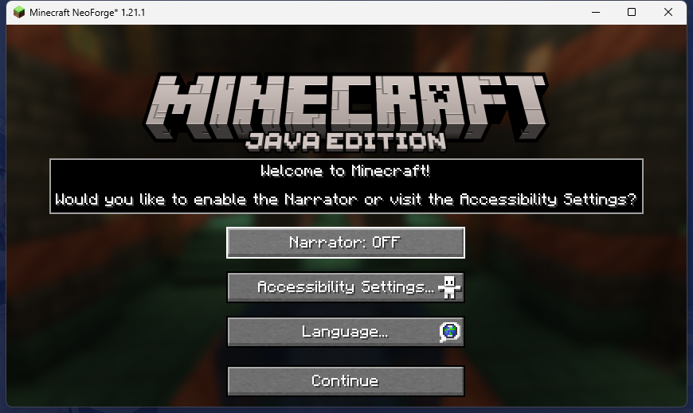

# mcbridge1201 使用说明与教程

> 一句话定位：**把 1.20.1 的 Fabric 模组往 1.21.1 迁、并提供一个能装能跑的本地启动器**；
> 迁移与验证归本工具，日常启动可以继续用 PCL —— 本工具是辅助，不替代 PCL。

这份说明面向两类人：

- **只想玩 / 只想用启动器**：看第 1–4 章，10 分钟能进游戏，也知道怎么用 PCL 接手；
- **想把 1.20.1 模组迁到 1.21.1**：从第 5 章开始，照着教程走一遍。

仓库不附带任何游戏 / 模组 / 转换件 jar；所有文件都在运行时下载或本地生成（见 [distribution.md](distribution.md)）。

---

## 1. 这是什么，不是什么

| 模块 | 作用 | 证据 |
|---|---|---|
| **本地启动器**（网页界面） | 离线安装/启动原版、Fabric、Forge、NeoForge；整合包、Java 运行时、模组启停、目录快捷入口 | [launcher.md](launcher.md)、[FINAL-STATUS.md](FINAL-STATUS.md) |
| **转换引擎** | CenturyBridge body-preserving 重映射 + 规则修补（field / method / body / superclass / ctor / rename / signature / mixin）+ javac 桥 | `rules/fabric-1.21.1/`、[baseline.md](baseline.md) |
| **证据与门禁** | 每次转换/启动的日志、verdict、哈希清单；门禁脚本防止“空实现/默认值/删 mixin 冒充通过” | `runs/`、`tools/verify_evidence.py` |

**不是**什么：

- 不是 PCL/HMCL 的替代品：没有账号体系、皮肤、多人认证、下载源管理；
- 不承诺任何模组“兼容”：`BOOTED` / `ok_partial` 只代表某个明确范围内的结果，见 [FINAL-STATUS.md](FINAL-STATUS.md)；
- 目前只实测 Windows（Linux/macOS 未验证）。

---

## 2. 环境准备

### 2.1 最低要求

- Windows 10/11 x64；
- **Java 21**（NeoForge 21.1 明确拒绝 Java 25；迁移引擎也按 21 构建）；
- Python 3.10+（启动器与工具脚本；核心只用标准库）；
- 可选：`pip install minecraft-launcher-lib`（Forge/NeoForge 的回退安装与命令拼装会用到，BSD-2）。

启动器会自动寻找 Java：你下载过的官方运行时（`%LOCALAPPDATA%\Packages\Microsoft.4297127D64EC6_*`）、
`JAVA_HOME`、`MC_JAVA`、PATH，或启动器自己装在 `<root>/runtime` 下的运行时。

### 2.2 本仓库的固定开发环境（复现用）

```powershell
$env:JAVA_HOME = '...\.toolchain\jdk'                  # JDK 21
$env:GRADLE_USER_HOME = '...\.toolchain\gradle-home'   # 仓库不放 gradle wrapper
```

构建细节见 [build.md](build.md)。

### 2.3 打开启动器

双击 `launcher\run.bat`，或：

```powershell
python launcher\server.py        # 默认 http://127.0.0.1:8765/
```

界面是本地网页（不是独立 exe）；关掉 Python 进程即关闭。

---

## 3. 启动器教程：从零到进游戏

界面分三块：左边是版本库，右边上方是“安装并启动”，下方是控制台。

### 3.1 第一次启动：原版 1.21.1

1. 右上角先确认 **Java** 状态点是绿的（红了说明没找到 Java 21）；
2. 左上“安装”页签里选 **最新正式版**（或输入 `1.21.1`）；
3. 加载器选 **原版**，点 **安装并启动**；
4. 首次会下载 client jar、libraries、natives、assets（资源 3900+ 个对象，网络慢是正常的），
   进度条与下方任务行会显示**文件数、已下载字节、实时速度和当前来源**；装完会自动启动；
5. 控制台会持续输出游戏日志；窗口标题出现 `Minecraft* 1.21.1` 就成功了。

### 3.2 Fabric（推荐）

- 加载器选 **Fabric**；“加载器版本”下拉可选具体版本，默认最新稳定；
- 同样点 **安装并启动**；已安装的版本再点一次就是直接启动。

### 3.3 Forge / NeoForge

- **Forge 1.20.1**：选 Forge → 安装并启动（走 `minecraft-launcher-lib`），实测可到主菜单；
- **NeoForge 1.21.1**：选 NeoForge → 安装并启动，首次会下载官方安装器并跑它的处理器
  （split / rename / binarypatch），**必须等它完整跑完**。实测 `21.1.264` 可到主菜单；
- 如果安装中断，日志会指出缺哪几件文件（`neoforge-client` / `neoforge-universal` /
  `client-*-srg` / `client-*-extra`），重新点安装即可；不要手工复制原版 jar 顶上。




### 3.4 装模组

1. 把模组 jar 放进 **全局** `<游戏目录>\mods`（不存在就点右上 **打开 mods**，会自动创建）；
2. “高级设置 → 模组”里可以 **启用 / 禁用**（改的是 `.jar` ↔ `.jar.disabled` 后缀，不删文件）；
3. `安装并启动` 时启动器不注入任何模组；模组是否兼容由模组自己决定。

> 模组兼容性、渲染类模组的 mixin 问题不在启动器范围内；本项目只对“迁移后的样本”负责，
> 且只到证据里写明的范围（见 [FINAL-STATUS.md](FINAL-STATUS.md)）。

### 3.5 存档、整合包、Java 运行时

- **存档**：`<游戏目录>\saves`，右上 **打开存档**；
- **整合包**：高级设置里选 `.mrpack` 或粘贴路径 → **安装整合包**，装完可自动启动；
  目前只验证过不含 `files` 的最小包（如实记录在 FINAL-STATUS）；
- **Java 运行时**：高级设置 → Java 运行时 → 选版本 → **安装到游戏目录**，会装到 `<root>/runtime`，
  启动时优先使用它。

### 3.6 删除版本

版本列表里点 **删除** 只删 `versions/<id>/`，**不动** `mods/`、`saves/`、`libraries/`、`assets/`；
路径穿越（`../`）会被拒绝。

---

## 4. 用其他启动器接手（PCL / HMCL / 官方）

安装出来的就是标准 `.minecraft` 结构：

```text
<root>/versions/<id>/<id>.json   版本描述
<root>/libraries/                共享库
<root>/assets/                   共享资源
<root>/launcher_profiles.json    官方启动器用的 profile
```

**PCL / HMCL**：`设置 → 游戏 → 游戏目录 → 添加`，选界面右上 **打开游戏目录** 打开的那个路径；
它们直接扫描 `versions/`，版本会出现在列表里。

**官方启动器**：只认 `launcher_profiles.json`。点高级设置里的 **让其他启动器识别**，会给每个
已安装版本补一条 profile（`lastVersionId` + `gameDir`）。

**关键差异是模组隔离**：

| 其他启动器的隔离设置 | 模组实际读取位置 | 怎么和本启动器共用 |
|---|---|---|
| 关闭（全局 / 不隔离） | `<root>/mods` | ✅ 直接共用 |
| 开启（按版本隔离） | `<root>/versions/<id>/mods` | 把 jar 复制进版本自己的 `mods` 目录 |

版本列表里每个已安装版本的 **目录** 链接可以直接打开 `versions/<id>/`。
目录接口与白名单校验见 [launcher.md](launcher.md)（`GET /api/dirs`、`POST /api/open-dir`）。

**离线 UUID**：由用户名生成。换启动器/换名字后 UUID 变了，单人存档里的玩家数据可能“看起来清空”，
保持同名即可，不是存档损坏。

---

## 5. 迁移教程：把 1.20.1 模组搬到 1.21.1

> 先读 [baseline.md](baseline.md) 的结论与 [limitations.md](limitations.md) 的边界；
> 这一章只给操作顺序，不重复所有细节。

### 5.1 准备材料（都不入库）

```text
work/target/client-1.21.1.jar           目标客户端 jar
work/target/client-1.20.1.jar           源客户端 jar
work/target/intermediary-1.21.1-v2.jar  目标 intermediary 映射
work/target/intermediary-1.20.1-v2.jar  源 intermediary 映射
work/target/fabric-api-*.jar            Fabric API（源/目标各一份）
work/corpus/*.jar                       待迁移模组（1.20.1）
```

抓取命令见 [build.md](build.md) 与 README 的“复现”一节（`tools/fetch_target_env.py`、
`tools/fetch_corpus.py`）。

### 5.2 静态分析：先看它“伤在哪”

```powershell
java\build\install\mcbridge1201\bin\mcbridge1201.bat analyze `
  --mods work/corpus `
  --client-jar work/target/client-1.21.1.jar `
  --mappings work/target/intermediary-1.21.1-v2.jar `
  --source-client-jar work/target/client-1.20.1.jar `
  --source-mappings work/target/intermediary-1.20.1-v2.jar `
  --source-api "work/target/fabric-api-0.92.12+1.20.1.jar" `
  --api "work/target/fabric-api-0.102.0+1.21.1.jar" `
  --api work/target/fabric-loader-0.19.5.jar `
  --target 1.21.1 --target-loader fabric `
  --out runs/p0-fabric-target/plan.json
```

产物 `plan.json` 里每个模组有 `ANALYZED` / `blocked_static` / `needs_dependency` 等状态。
**静态通过 ≠ 能启动**，它只说明引用的类/方法在目标里“看起来还在”。

### 5.3 第一遍转换：CenturyBridge

```powershell
python tools/prepare_cb.py     # 生成 work/cb/data（jar、映射、分段）
# 按 docs/engine-selection.md 的“真实尝试”执行上游 engine-cli 的 7 段转换
```

产物在 `work/cb/out/<模组>/`，报告在 `work/cb/out/<模组>/report.md`。常见结果：

- `ok_partial`：能产出 jar，但有 tombstone（无法映射的成员被剔除）；
- **tombstone 不是“没问题”**：它意味着相关调用点在运行时会 `NoSuchMethodError`。

### 5.4 第二遍转换：自研 body-preserving remapper

```powershell
java\build\install\mcbridge1201\bin\mcbridge1201.bat remap-jar `
  --in work/corpus/<mod>.jar --out work/remap/<mod>-intermediary.jar `
  --mappings work/target/intermediary-1.21.1-v2.jar
```

它保留方法体，只改引用；对 6148 类服务端 jar 验证过 0 结构损失（[baseline.md](baseline.md) §7.3）。

### 5.5 规则修补 + javac 桥

规则在 `rules/fabric-1.21.1/*.json`，每条规则/桥都有 capability、risk、evidence 三元信息。
以容器类改动为例：

```powershell
java\build\install\mcbridge1201\bin\mcbridge1201.bat patch `
  --in work/remap/<mod>-intermediary.jar --out work/cb/out/<mod>/patched.jar `
  --rules rules/fabric-1.21.1/container.json `
  --client-jar work/target/client-1.21.1.jar `
  --mappings work/target/intermediary-1.21.1-v2.jar
```

规则类型：

| 类型 | 用途 | 例子 |
|---|---|---|
| `field` / `method` / `body` | 替换成员引用、改写方法体 | `ItemPredicate.ANY` → 空谓词 |
| `superclass` / `ctor` | 父类或构造器签名变化 | 构造器 + 参数适配 |
| `rename` | 类/成员改名 | 映射缺失时的显式改名 |
| `signatureAdaptations` | 目标方法参数变多（如 BlockEntity NBT 加 WrapperLookup） | `container.json` |
| `callSiteAdaptations` | 调用点签名变化 → 生成 javac 桥 | lithium `class_14.method_59` |
| `mixinCallbackAdaptations` | Mixin 回调描述符适配（append/replace + refmap） | Explosion 回调 |
| `mixinClassReplacements` | Mixin 实现类整体替换 | chunk access 移植到 `ChunkResult` |
| `bridge-dir` | 把 javac 编译的桥类打进 jar | 减少反射/字符串拼装风险 |

桥的编译与注入：

```powershell
python tools/build_bridges.py --stub work/cb/data/jars/client-1.21.1-intermediary.jar `
  --lib work/lib/gson-2.11.0.jar --out work/bridges
python tools/inject_bridges.py --jar work/cb/out/<mod>/patched.jar `
  --out work/cb/out/<mod>/patched-bridge.jar --classes work/bridges `
  --replace top/mcbridge1201/bridge/ItemPredicateAny
```

桥一致性检查（不同 jar 里的同名桥必须字节一致，否则先加载的那份会“赢”）：

```powershell
python tools/check_bridge_consistency.py --bridge-dir work/bridges --jar work/instances/*/mods/*.jar
```

### 5.6 运行时验证：服务端 → 客户端

```powershell
# 专用服务端：看到 Done 才算 BOOTED
python tools/run_server.py --instance work/instances/fabric-1.21.1-server `
  --log runs/p1-server-baseline/server.log --timeout 300

# 容器契约：放置 → 插 5 钻石 → 读 NBT → 重启 → 再读
python tools/run_contract.py --instance work/instances/fabric-1.21.1-server `
  --out runs/p5-contract-script/verdict.json
```

客户端则用第 3 章的启动器流程：装 Fabric 1.21.1 → 把迁移后的 jar 放进 `mods/` → 启动 →
进世界做对应玩法验证。渲染类模组还需要 mixin 重写能力，**目前未完成**（FINAL-STATUS 有明确记录）。

### 5.7 读懂报告与“通过”的含金量

| 标记 | 含义 | 能不能说“兼容” |
|---|---|---|
| `ANALYZED` | 静态分析跑完 | 不能 |
| `BOOTED` | 进程启动到 `Done`/主菜单 | 不能 |
| `passed_within_scope` | 在写明的契约/场景内通过 | 只能说“该范围内通过” |
| `ok_partial` / `ok_degraded_partial` | 转换有 tombstone 或剥离了 load-bearing mixin | 不能 |
| `failed` | 有真实崩溃/断言失败 | 不能 |

证据在 `runs/`，索引在 `runs/SHA256SUMS.txt`；`tools/verify_evidence.py` 会校验这些文件没有被
事后改写。

---

## 6. 门禁：改完代码必须跑的四个命令

```powershell
gradle -p java test installDist          # Java 单测 + 可执行发行目录
python tools/check_hashes.py             # 证据哈希清单
python tools/verify_evidence.py          # 证据 + 回归（含 test_review_fixes）
python tools/test_review_fixes.py        # 外部问题回归（35 项，含 NeoForge/目录/说明页）
```

CI（GitHub Actions）跑同样的 Java 测试与语法检查。注意：用 gh API 推送不会自动触发 Actions，
需要手动 dispatch：

```powershell
gh api --method POST repos/SelYio666/mcbridge1201/actions/workflows/ci.yml/dispatches -f ref=master
```

---

## 7. 常见问题（FAQ）

**Q1：启动器显示 Java 红色 / 找不到 Java 21。**
装 JDK 21 并在高级设置里把游戏目录指向可写目录，或用“Java 运行时”页签安装到 `<root>/runtime`；
NeoForge 21.1 不能用 Java 25。

**Q2：下载卡住 / SSL EOF。**
Mojang CDN 与 maven 偶尔不可达；启动器对资源、库、Mojang 元数据、Fabric meta 和
**Fabric Loader** 有**逐路径验证**的 BMCL 镜像兜底（Fabric API / intermediary 在 BMCL 是 404，
所以不替换，只重试）。每个地址最多重试 3 次，404 会立刻换源；下载记录可用
`GET /api/downloads` 查看真实来源和失败原因。详见 [download-sources.md](download-sources.md)。
Python 侧用 urllib 而不是 requests（本机 requests 会 SSL EOF）。重试通常能继续（已下载文件会跳过）。

**Q3：NeoForge 启动报 `DisplayWindow.updateModuleReads` / `No value present`。**
安装不完整：没跑完官方安装器的处理器。重新安装，确认 `libraries/net/neoforged/neoforge/<ver>/`
下有 `neoforge-<ver>-client.jar` 与 `-universal.jar`，以及 `libraries/net/minecraft/client/`
下的 `client-*-srg.jar` / `-extra.jar`。`mclaunch.py verify neoforge-<ver> <root>` 会逐项报告。

**Q4：用 PCL 打开却看不到模组。**
PCL 开了版本隔离，读的是 `versions/<id>/mods`；关掉隔离用全局 `<root>/mods`，或把 jar 复制过去。

**Q5：换启动器后存档像“清空”了。**
离线 UUID 由用户名生成；保持同名即可。不是文件损坏，也请不要在不同名字之间反复切换同一个存档。

**Q6：删除版本会删存档/模组吗？**
不会，只删 `versions/<id>/`。但删除前仍建议备份。

**Q7：整合包装完没反应？**
目前只验证无 `files` 的最小 mrpack；含下载文件的包还需要更多验证（FINAL-STATUS 已列出）。

**Q8：转换后启动成功，能说这个模组兼容了吗？**
不能。看 5.7 的表：`BOOTED` 只说明能启动，玩法/存档/联机都要单独证据。

---

## 8. 边界（如实）

- **不宣称兼容**：仓库交付的是工具、规则、证据与明确范围内的结果；
- **不分发**游戏/模组/转换件 jar；`work/` 被 `.gitignore` 忽略；
- **渲染类模组**（Sodium / Iris / EntityCulling / ImmediatelyFast）仍需要 mixin 重写能力，未通过；
- **NeoForge** 只验证了空实例 21.1.264 到主菜单，未测 NeoForge 模组与进世界；
- **平台**：仅 Windows 实测。

---

## 9. 把启动器发给别人（免 GitHub 便携包）

如果你要把启动器分享给不用 GitHub 的朋友，可以打一个**免安装便携包**（约 12 MB）：

```powershell
python tools/build_portable.py --label 0.3.5
# -> dist/mcbridge-launcher-0.3.5.zip
```

包里只有本项目代码 + 官方嵌入式 Python 3.12 + 可选的 `minecraft-launcher-lib`，
**不含任何 Minecraft / 模组 jar**；对方解压后双击 `run.bat` 就能用，不用装 Python。

- 对方**第一次启动仍需联网**下载游戏（国内自动走 BMCLAPI 镜像），但不需要为“拿包”翻墙；
- 分享渠道：网盘（百度 / 123 / 夸克 / 蓝奏）、QQ 群文件、GitHub Release 资产；
  第三方 GitHub 加速镜像只当救急，别作为唯一入口；
- 不要把 `work/`、游戏 jar、模组 jar、你自己的 `launcher/config.json` 放进分享包
  （构建脚本已排除 config.json）；
- 许可证：本项目 MIT；内置 Python（PSF）与 minecraft-launcher-lib（BSD-2）的许可证原文
  会随包附在 `THIRD-PARTY-LICENSES/` 下。

细节与渠道对比见 [distribution.md](distribution.md) §2.5。

---

## 附录：命令速查

```text
# 启动器
launcher\run.bat
python launcher\server.py
python launcher\mclaunch.py install <mc> <root> [vanilla|fabric|forge|neoforge]
python launcher\mclaunch.py launch <version_id> <root> <username>
python launcher\mclaunch.py verify <version_id> <root>
python tools\build_portable.py --label <版本>   # 便携包（内置 Python，免安装）
python tools\test_portable.py --root <root> [--version <vid>]   # 便携包自检
python tools\test_launcher_e2e.py --root <root> [--version <vid>] [--require "<marker>"]

# 转换/分析
java\build\install\mcbridge1201\bin\mcbridge1201.bat doctor
... analyze ... / index-info ... / remap-jar ... / patch ... / refs ...
python tools\prepare_cb.py
python tools\build_bridges.py --stub <jar> --out work\bridges
python tools\inject_bridges.py --jar <in> --out <out> --classes work\bridges --replace <class>
python tools\audit_mixins.py --jar <jar>
python tools\check_bridge_consistency.py --bridge-dir work\bridges --jar <jar>...

# 运行时验证
python tools\run_server.py --instance <dir> --log <file> --timeout 300
python tools\run_contract.py --instance <dir> --out <verdict.json>
python tools\run_chunk_stress.py ...

# 门禁
gradle -p java test installDist
python tools\hash_evidence.py
python tools\check_hashes.py
python tools\verify_evidence.py
python tools\test_review_fixes.py
```

更多细节：[launcher.md](launcher.md)（启动器）、[baseline.md](baseline.md)（引擎与规则细节）、
[handoff.md](handoff.md)（一页交接）、[FINAL-STATUS.md](FINAL-STATUS.md)（已验/未验总表）。
