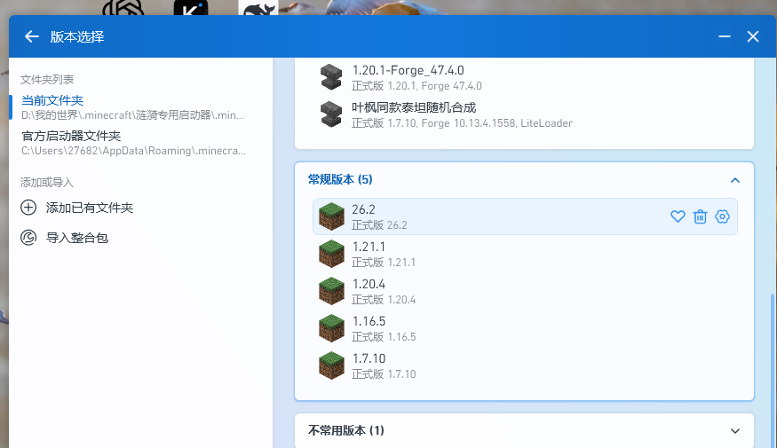

# p137 — 一键对接 PCL2（真实环境验证）

日期：2026-10-24。目标：把“下载源安装”直接对接到用户机器上的 PCL2，并在 PCL2 里看到新版本。

## 环境

- PCL2 便携版：`D:\我的世界\.minecraft\涟漪专用启动器\Plain Craft Launcher 2.exe`
- 配置：`PCL\Setup.ini` 里 `LaunchFolderSelect:$.minecraft\` → 游戏目录为
  `D:\我的世界\.minecraft\涟漪专用启动器\.minecraft`（PCL2 自带的 `.minecraft`，已有多个实例）。

## 做了什么

```text
python tools/from_source_install.py --version 1.20.4 --pcl2 "D:\我的世界\.minecraft\涟漪专用启动器"
```

- `--pcl2` 读取 `PCL/Setup.ini` 的 `LaunchFolderSelect`，解析出真实游戏目录；
- 安装 1.20.4（约 9 秒，资源与已有版本复用），写 `launcher_profiles.json`；
- 打开 PCL2 →「版本选择」，**常规版本 (5)** 中出现 `1.20.4`：



## 结论

- 文件系统层面的对接（版本目录 + profile）与 PCL2 的识别都验证通过；
- PCL2 便携版不需要手动指定游戏目录：`--pcl2 <启动器目录>` 即可；
- 命令行/双击 exe 时，若 PCL2 在桌面有快捷方式，自动检测也会走这条路径。

## 备注

- 版本列表截图为 PCL2 窗口裁剪，已去掉桌面内容；
- 本次只验证“安装后 PCL2 能列出该版本”，未做“从 PCL2 启动进游戏”（那需要真实 GPU 窗口与账号）。
