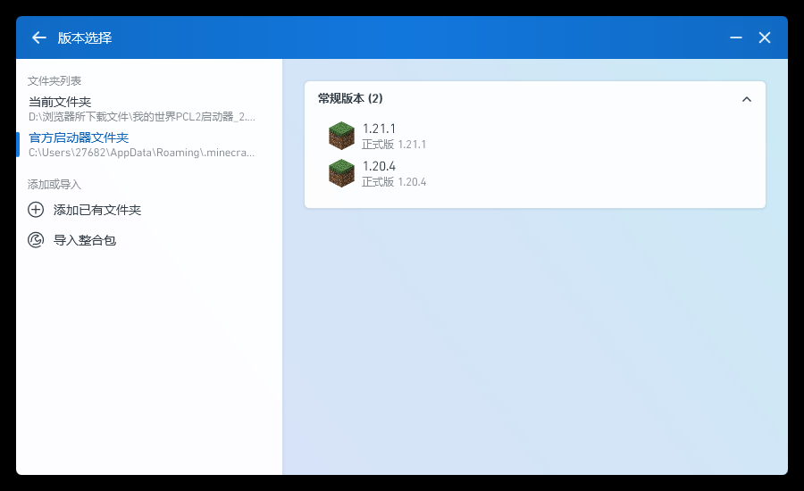

# p212：一次真实的「面板点安装 → PCL2 里看得见」，顺带把启动器更到快照版 2.99.0.0

p211 把环境钉死了（PCL2 在、游戏目录在、失效快捷方式不再静默），但**从没人在真机上按过那个按钮**。
这一轮做完整条链：

```
重建桌面快捷方式  →  清掉上次装出来的 1.20.4  →  面板点「安装到 PCL」  →  PCL2 版本选择里出现 1.20.4
                                        （同时把启动器从 2.13.1.1 换成快照版 2.99.0.0）
```

判定：`verify_e2e.py` **29/29**。

## 结果

| 环节 | 结果 | 证据 |
|---|---|---|
| 桌面快捷方式 | 由死路径 `D:\我的世界\.minecraft\涟漪专用启动器\…` 改为真实启动器；旧 `.lnk` 字节留档 | `shortcut.json`、`desktop-shortcut-before.lnk` |
| 检测链路 | `pcl2_from_desktop()` 现在**沿快捷方式**解析出 `C:\Users\27682\AppData\Roaming\.minecraft`（p211 时是 `None`，靠兜底） | `shortcut.json` |
| 起点干净 | 上一轮装的 `versions\1.20.4` 与 `mcbridge-1.20.4` profile 被删除并记录，`profiles` 只剩 `PCL` | `clean-state.json` |
| 面板安装 | 点的是面板自己的按钮命令：`完成`，10.3 s；`versions` 由 `['1.21.1']` 变 `['1.20.4','1.21.1']`；写入 `1.20.4.jar` 24,445,539 B、`1.20.4.json` 49,394 B；新增 profile `1.20.4 (mcbridge)` | `install.json`、`panel-after-install.png` |
| 文件真伪 | `1.20.4.json` 是官方 manifest（`id=1.20.4`、`assetIndex=12`），`1.20.4.jar` 的 sha1 与 manifest 的 `downloads.client.sha1` 一致 | `verify_e2e.py` 现场重算 |
| 启动器更新 | 2.13.1.1 → **2.99.0.0**：解压 zip 覆盖 exe，sha256 与 zip 成员逐字节相同，旧 exe 存为 `Plain Craft Launcher 2.exe.2.13.1.1.bak`，`PCL\Setup.ini` 未动 | `launcher-update.json` |
| PCL2 里看得见 | 启动 2.99.0.0 → 更新日志弹窗 → 「版本选择」页 **常规版本 (2)：1.21.1 / 1.20.4** | `pcl2-window.png`（更新日志）、`pcl2-click-1.png`、`pcl2-click-2.png` |



## 复现

```bash
cd "/c/Users/27682/Documents/新建文件夹/mcbridge1201"

# 1. 快捷方式（--restore 用于重跑时把被写坏的 .lnk 恢复成原始状态）
py -3.12 runs/p212-pcl2-e2e/rebuild_shortcut.py \
    --restore runs/p212-pcl2-e2e/desktop-shortcut-before.lnk \
    --target "D:\浏览器所下载文件\我的世界PCL2启动器_2.12.8.2\plain craft launcher 2.exe" \
    --out runs/p212-pcl2-e2e

# 2. 清掉上次装出来的版本，让一次点击自己给出 before/after
py -3.12 runs/p212-pcl2-e2e/clean_state.py --version 1.20.4 --out runs/p212-pcl2-e2e

# 3. 面板真点（会写真机 .minecraft；assets 已缓存时约 10 s，全新约 30 s）
py -3.12 runs/p212-pcl2-e2e/panel_install.py --version 1.20.4 --out runs/p212-pcl2-e2e

# 4. 启动器更新（快照版）
py -3.12 runs/p212-pcl2-e2e/update_launcher.py \
    --zip "D:\浏览器所下载文件\PCL 快照版 2.99.0.0.zip" \
    --launcher-dir "D:\浏览器所下载文件\我的世界PCL2启动器_2.12.8.2" \
    --out runs/p212-pcl2-e2e

# 5. 启动 PCL2 并点开「版本选择」截图
py -3.12 runs/p212-pcl2-e2e/pcl2_open.py \
    --exe "D:\浏览器所下载文件\我的世界PCL2启动器_2.12.8.2\plain craft launcher 2.exe" \
    --out runs/p212-pcl2-e2e --click 1093,722 --click 608,815

# 6. 判据
py -3.12 runs/p212-pcl2-e2e/verify_e2e.py
```

## 诚实的边界（哪些是替身、哪些不是）

- **真实**：Tk 窗口、面板自己的 `install_btn.invoke()`（等于点击）、`from_source_install.install()`、
  Mojang 官方下载、写进真机 `C:\Users\27682\AppData\Roaming\.minecraft`、PCL2 真启动 + 真点击。
- **替身只有模态弹窗**：`messagebox.showinfo/showerror/showwarning` 被替换成记录函数
  （`install.json` 的 `dialogs` 里有完整文案）。无人值守时模态框会卡死流程，除此之外没有替身。
  `open_var` 关掉，避免装完弹出资源管理器。
- **第二次起 `assets/libraries` 走缓存**：`clean_state.py` 只删版本目录和 profile（`assets`、
  `libraries` 与 1.21.1 共用，不属于这次安装）。所以 10.3 s 那一轮 `progress` 里没有逐 200 条的
  assets 计数——`verify_e2e.py` 因此只断言"面板确实跑到了 client + assets 两个阶段"，
  不去断言一个缓存命中时不会出现的数字。
- **没有做**：从 PCL2 点「启动游戏」进世界（需要账号/GPU 会话，p137 也没做）；1.21.1 的启动回归。
- **写在真机上的东西**：`versions\1.20.4\`（24 MB jar + json）、`launcher_profiles.json` 里的
  `mcbridge-1.20.4`、`assets` 里 1.20.4 新增的对象、启动器 exe 被替换（旧版留 .bak）。
  想去掉就删 `versions\1.20.4` 与该 profile，启动器回滚用 `.bak`。

## 两个顺带发现

1. **PCL 2.99.0.0 不再自带 MC 下载**（更新日志第一条：「为遵守相关法律法规，PCL 暂时不再提供 MC
   下载功能」）。所以"用 PCL 装 1.21.1"这条路在新启动器上没了，本仓库的一键安装器反而更有用；
   版本管理被改成「允许修改、添加、移除已安装版本的各个组件」。
2. **PCL2 是单实例**：已有一个实例在跑时，再启动的新进程会立刻退出，脚本会"找不到窗口"。
   `pcl2_open.py` 因此先按镜像名杀掉已有实例（记录在 `killed_existing`）再启动，
   否则截到的是上一个会话的陈旧画面。

## 踩过的坑

1. **中文路径不能进 `powershell -Command "..."`**：第一次重建快捷方式时，`D:\浏览器所下载文件\…`
   被吞成 `D:\PCL2_2.12.8.2\…`，写出一个指向不存在目录的快捷方式。改成"把脚本写成 UTF-8 **带 BOM**
   的 `.ps1`，用 `-File` 跑，结果写 JSON 文件"才稳。
2. **exe 被旧进程占着**：更新启动器时 `PermissionError`，先 `Stop-Process -Name "plain craft launcher 2"`。
   顺带一提：PowerShell 里 `taskkill //PID` 是错的（那是 MSYS 写法），用 `Stop-Process` 或 `/PID`。
3. **面板关窗时的后台线程**：`_load_versions` 在 root 销毁后还调 `root.after` → 线程打
   `RuntimeError: main thread is not in main loop`。已修：面板加 `_post()` 统一兜住
   `RuntimeError/TclError`，`_drain` 的自我调度也走它。
4. **截图要等"能画出来"的窗口**：PCL2 先弹「应用程序正在打开，请稍候」，此时 `PrintWindow`
   拿不到内容。`pcl2_open.py` 改成轮询"最大的窗口 + 截图成功"才算就绪。
