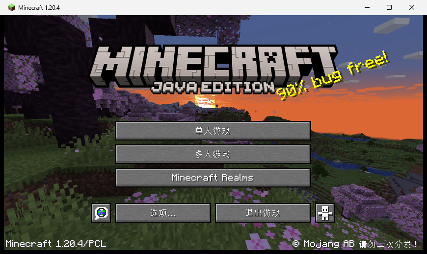
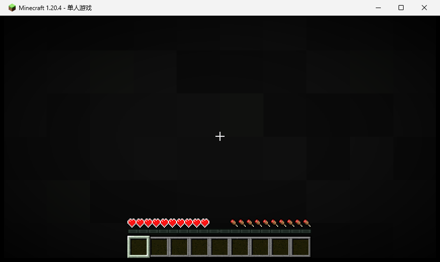

# p213：离线模式当然能启动——PCL2 用离线身份把 1.20.4 拉起来了

p212 结尾我写了一句"没做：从 PCL2 进世界（要账号）"，**那是错的**。PCL2 的「离线」模式就是
不需要账号：指定一个用户名，启动器给游戏一个占位 UUID/token。这一轮把它跑通。

判定：`verify_launch.py` **19/19**。

## 结果

| 环节 | 结果 | 证据 |
|---|---|---|
| 离线身份 | PCL2 的「离线」登录（用户名 `SelYio`） | `home.png`（离线标签高亮 + 用户名） |
| 选版本 | 在「版本选择」里点 `1.20.4`（p212 面板装出来的那个） | `versions.png` |
| 启动 | 点「启动游戏」→ PCL2 拉起 java，窗口标题 `Minecraft 1.20.4` | `drive.json` 的 `wait-game` |
| **离线证据在 argv 里** | `--username SelYio`、`--uuid 0000000000003006998F555B73D6DCEF`、`--accessToken`（同一个占位值）、`--userType msa`、`-Dminecraft.launcher.brand=PCL` | `drive.json` 的 `ps` |
| 进到标题界面 | 日志 `Setting user: SelYio` → `Sound engine started`；截图是标题界面 | `game-title.png`（392 KB，与启动闪屏差 90%） |
| 没有崩溃 | 只有离线模式必然出现的 3 条错误（Realms 认证 401、`Failed to fetch user properties`、`profile key pair`） | 日志 + `launch-check.json` |
| 游戏内点击也生效 | 点「单人游戏」→ 进入创建世界页（画面变 90%） | `world-select.png` |
| **进世界成功** | 点「单人游戏」→ 世界列表点 `新的世界` →「进入选中的世界」：日志 `Time elapsed: 1413 ms`，标题变 `Minecraft 1.20.4 - 单人游戏`，`saves\新的世界\` 已存在 | `world-list.png`、`in-game.png` |





## 复现

```bash
cd "/c/Users/27682/Documents/新建文件夹/mcbridge1201"

py -3.12 runs/p213-pcl2-offline-launch/drive_pcl.py \
    --exe "D:\浏览器所下载文件\我的世界PCL2启动器_2.12.8.2\plain craft launcher 2.exe" \
    --out runs/p213-pcl2-offline-launch --version 1.20.4 \
    --step "activate" --step "shot:home" \
    --step "click:608,820" --step "sleep:2" --step "shot:versions" \
    --step "click:930,525" --step "sleep:3" --step "shot:selected" \
    --step "click:675,765" --step "wait-game:200" --step "wait-title:240" \
    --step "ps" --step "log" \
    --step "click-game:435,267" --step "sleep:3" --step "shot-game:world-select" \
    --step "click-game:277,437" --step "sleep:4" --step "shot-game:world-clicked" \
    --step "wait-world:60" --step "log"

py -3.12 runs/p213-pcl2-offline-launch/verify_launch.py
```

坐标都是屏幕绝对坐标（`click` 是启动器窗口，`click-game` 是游戏窗口内的相对坐标）；
`activate` 会先抢前台并回报 `foreground`，`wait-game` / `wait-title` / `wait-world` 分别等
"窗口出现"、"日志出现 `Sound engine started`"、"日志出现世界加载行"。

## 三个必须记住的坑（都踩到了）

1. **`SetForegroundWindow` 不够**：后台进程直接调它，Windows 经常直接拒绝。第一轮就是这样——
   `foreground: false`、点击落到终端、页面没变，而脚本还"成功"返回了。现在用 p202/p204 那套
   `AttachThreadInput` 借前台线程的权限，并**把 `foreground` 写进证据**。
2. **被最小化的窗口要先恢复再量坐标**：游戏启动后常被最小化到 `(-32000,-32000)`；
   `SW_RESTORE` 会把它挪回自己的位置，所以"先量矩形再激活"拿到的坐标是过期的——第一次点
   「创建新的世界」就因此偏了 119 px，点到「允许作弊」。
3. **"窗口出现" ≠ "游戏起来了"**：先出现的是 Mojang 红底闪屏。`wait-title` 等日志里的
   `Sound engine started` 才算到标题界面，然后才截图。

## 进世界这一段（以及一次没生效的点击）

- **本轮的成功路径全是点击**：标题界面点「单人游戏」→ 世界列表（`新的世界 (2026/10/30 20:26) 生存模式，
  版本：1.20.4`）→ 点这一行 → 点「进入选中的世界」→ 日志 `Time elapsed: 1413 ms`，窗口标题变
  `Minecraft 1.20.4 - 单人游戏`，`versions\1.20.4\saves\新的世界\` 出现；
- **早前的一次失败，如实留着**：第一次是点创建世界页的「创建新的世界」，同坐标 hover 无高亮、
  点击后画面只少了 tooltip（`world-select.png` 与 `world-clicked.png` 的全部差别就是这个），
  日志没有世界加载行；在那一页**按 Enter** 才把世界建出来（`diag-enter.png` 是按下后出现的世界预览帧
  "1×"）。所以"合成点击进 GLFW 窗口"是成立的（标题界面与世界列表都点得动），但创建世界页**那一个
  按钮**为什么不吃点击，本轮没有查清，也不据此下结论；
- **一条未查清的日志**：日志里有 `[Server thread/ERROR]: Not a string`，出现在玩家加入世界那一瞬间
  （紧接着就是 `SelYio[local:E:…] logged in with entity id 1`）。来源没查到；它被显式列进
  `verify_launch.py` 的允许名单，并**单独成一条检查**（"named in the verdict"），没有悄悄过滤掉。

## 边界

- 只验证到「离线启动 + 标题界面 + 进世界 + 游戏内点击生效」；创建世界页那个按钮不吃合成点击
  **没查清**（世界是那一页按 Enter 建出来的）；
- 用的是 PCL2 2.99.0.0 自带的 `java-runtime-delta`（未用系统 JDK）；版本目录是 PCL 的隔离模式
  （`--gameDir ...\versions\1.20.4`），所以日志在 `versions\1.20.4\logs\latest.log`，不在
  `.minecraft\logs`；
- 截图是 `PrintWindow` 拿的窗口位图，GLFW 窗口能拿到（p204 起一直如此）；
- 结束后游戏已关闭（没有留 java 进程）。
