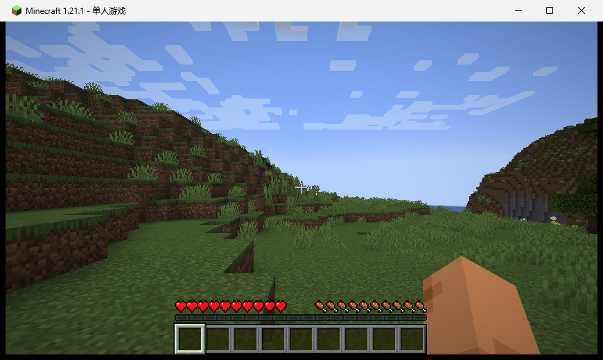

# p214：1.21.1 也走通了同一条离线路径（PCL2 → 离线身份 → 标题界面 → 进世界）

p213 证明的是 **1.20.4**（面板装出来的那个）能离线启动并进世界。1.21.1 是另一回事：它早就由 PCL2
自己装在机器上，是本仓库所有模组转换的目标版本，**但在 PCL2 里从没启动过一次**。这一轮用同一套驱动
把它跑了一遍，结论一致。

判定：`verify_1211.py` **19/19**。

## 结果

| 环节 | 结果 | 证据 |
|---|---|---|
| 启动器与选版 | PCL2 2.99.0.0 → 版本选择里点 `1.21.1` | `versions.png` |
| 启动 | PCL2 拉起 `Minecraft 1.21.1`（PCL 自带 `java-runtime-delta`） | `drive.json` 的 `wait-game`：`title=Minecraft 1.21.1` |
| 离线身份（argv） | `--username SelYio`、`--uuid`/`--accessToken` = `0000000000003006998F555B73D6DCEF`、`--userType msa`、`--version 1.21.1`、`-Dminecraft.launcher.brand=PCL` | `drive.json` 的 `ps` |
| 标题界面 | `Setting user: SelYio` → `Sound engine started`，截图 350 KB（与闪屏差 90%） | `game-title.png` |
| 进世界（点击） | 标题界面「单人游戏」→ 世界列表 → 点该行 →「进入选中的世界」→ `Time elapsed: 229 ms` | `world-list.png`、`in-game.png` |
| 磁盘 | `versions\1.21.1\saves\新的世界\` 存在 | `verify_1211.py` 现场检查 |
| 错误 | 只有离线必然的两条（`Failed to fetch user properties`、`Couldn't connect to realms`）；**没有** 1.20.4 那条 `Not a string` | 日志 + `launch-check.json` |



> 这个世界的**创建**是几分钟前在创建世界页按 Enter 完成的（点「创建新的世界」按钮不生效，
> 与 p213 里 1.20.4 的情况一样）；那次的两帧留作 `world-entry.png` / `after-enter.png`。
> 本轮是**用点击进入**这个世界，所以判据断言的也是点击路径。

## 复现

```bash
cd "/c/Users/27682/Documents/新建文件夹/mcbridge1201"

py -3.12 runs/p213-pcl2-offline-launch/drive_pcl.py \
    --exe "D:\浏览器所下载文件\我的世界PCL2启动器_2.12.8.2\plain craft launcher 2.exe" \
    --out runs/p214-pcl2-1211 --version 1.21.1 \
    --step "activate" --step "shot:home" \
    --step "click:608,820" --step "sleep:2" --step "shot:versions" \
    --step "click:930,472" --step "sleep:2" --step "shot:selected" \
    --step "click:675,765" --step "wait-game:300" --step "wait-title:360" \
    --step "ps" --step "log" \
    --step "click-game:435,267" --step "sleep:3" --step "shot-game:world-list" \
    --step "click-game:435,160" --step "sleep:2" --step "shot-game:world-selected" \
    --step "click-game:277,428" --step "sleep:4" --step "shot-game:world-loading" \
    --step "wait-world:240" --step "log"

py -3.12 runs/p214-pcl2-1211/verify_1211.py
```

驱动脚本复用 `runs/p213-pcl2-offline-launch/drive_pcl.py`（`click` 是启动器窗口的屏幕绝对坐标，
`click-game` 是游戏窗口内的相对坐标，`wait-title` 等日志里的 `Sound engine started`）。
`930,472` 是版本列表里 1.21.1 那一行（1.20.4 在 `930,525`）。

## 边界

- 只到「离线启动 → 标题界面 → 进世界」；没做游戏内玩法、多人、模组加载（这个实例里没有任何转换件）；
- 世界是用**点击**进入的；创建它那一步用的是 Enter（按钮不吃合成点击，p213 已记录，本轮没再查）；
- 结束后游戏与启动器进程都已关闭；
- 写进真机的东西：`versions\1.21.1\saves\新的世界\`（新世界）。
