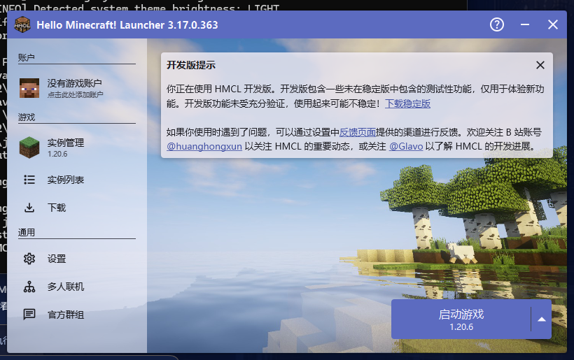

# p222 — 一键安装对接 HMCL（3.17.0.363）

日期：2026-10-31。目标：把“下载源安装”同样对接到 HMCL，并在 HMCL 里看到新装的版本。

## 环境与配置

- 测试用 HMCL **3.17.0.363**（官方 GitHub Release 的 `HMCL-3.17.0.363.jar`，Java 21 运行），
  放在 `work/tmp/hmcl-test/`；
- HMCL 的目录配置有两种：

| 安装形态 | 配置文件 | 路径语义 |
|---|---|---|
| 普通安装 | `%APPDATA%\.hmcl\config\user-game-directories.json` | `path` 为绝对路径 |
| 便携（本机实测） | `<启动目录>\.hmcl\config\game-directories.json` | `path` 是**相对启动目录**的 `.minecraft` |

本机 HMCL 是便携形态，因此 **`%APPDATA%\.minecraft` 里装的东西它看不到**——第一次测试就撞到了这个：
HMCL 显示“没有游戏实例”。

## 实现

- `--hmcl`：读 `%APPDATA%\.hmcl\config\user-game-directories.json`，取第一个存在的目录；
  再不行退回 `%APPDATA%\.minecraft`；
- `--hmcl-dir <dir>`：显式指定游戏目录（便携版/自定义目录用它，直接当作游戏根目录）；
- `p222-hmcl/verify.py`：5/5（配置解析、APPDATA 回退、显式目录、嵌套 `.minecraft`、空目录返回 None）。

## 实测

```text
python tools/from_source_install.py --version 1.20.6 --hmcl-dir "...\hmcl-test\.minecraft"
```

- 为了不重复下载资源，测试目录的 `assets` / `libraries` 用 junction 指向 `%APPDATA%\.minecraft`；
- 1.20.6 装好并写了 `launcher_profiles.json`；
- 重启 HMCL 后，左侧「游戏 → 实例管理」显示 **1.20.6**，右下角按钮是「启动游戏 1.20.6」：



## 顺带修的网络问题

第一次安装时 Mojang 清单连续 3 次 `SSL: UNEXPECTED_EOF_WHILE_READING`，而同一时刻 `urllib3`
能拿到 200。于是 `from_source_install.py` 改成：

- 优先 urllib3 连接池（keep-alive + gzip），`urllib` 兜底；
- 清单/JSON 请求 3 次重试；异常转为一行可读错误，不再抛 traceback。

## 结论

- HMCL（普通/便携）都能通过 `--hmcl`/`--hmcl-dir` 对接；便携版必须用 `--hmcl-dir` 或把 HMCL
  的游戏目录改成绝对路径；
- HMCL 3.17 能直接列出装进其游戏目录的版本，无需额外 profile。
