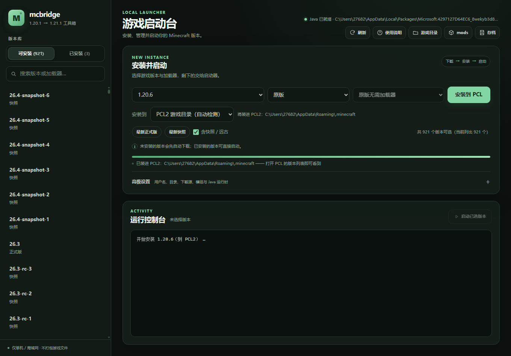

# p223 — 网页启动器「安装到 PCL2」的真实点击 E2E

日期：2026-10-31。目标：不是只测 API，而是在浏览器里真的选版本、切目标、点按钮。
另一件事：把网页启动器的新功能打成发布包，并修掉打包版 `/api/pcl` 缺模块的问题。

## 结果

- 驱动方式：Edge 无头 + 手写 CDP/RFC6455（本机没有 selenium/websocket 包），
  脚本 `runs/p223-launcher-pcl-ui/drive.py`；
- 页面里执行：选 `1.20.6`、加载器 `原版`、安装位置切到 `PCL2 游戏目录（自动检测）`，
  等提示更新后点「安装到 PCL」；
- 真实结果（`ui-result.json`）：

```json
{"mc": "1.20.6", "loader": "vanilla", "target": "pcl",
 "hint0": "将装进 PCL2：C:\\Users\\27682\\AppData\\Roaming\\.minecraft",
 "msg": "已装进 PCL2：C:\\Users\\27682\\AppData\\Roaming\\.minecraft —— 打开 PCL 的版本列表即可看到",
 "button": "安装到 PCL"}
```



- 按钮文案随目标切换（`安装并启动` → `安装到 PCL`）；
- 提示行显示检测到的目录；装完不本地启动，而是指向 PCL 版本列表。

## 打包版的问题与修复

`tools/build_portable.py` 原来只打 `launcher/`，没带 `tools/from_source_install.py`，
所以发布包里 `/api/pcl` 返回 `{"dir": null, "notes": ["检测失败: No module named 'from_source_install'"]}`。
修复：打包时把该文件复制到 `tools/`；重建后同一接口返回
`{"dir": "C:\\Users\\27682\\AppData\\Roaming\\.minecraft", "notes": []}`。

## 产物

- `dist/mcbridge-launcher-0.5.10.zip`（11,974,420 B，含网页启动器新功能与 PCL 检测）；
- 发布：v0.5.10（launcher zip）。
