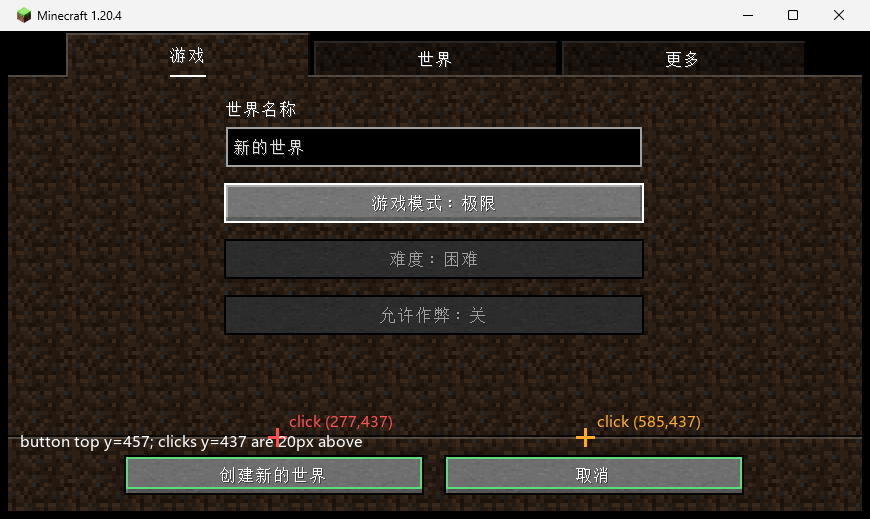

# p226 — 纠正 p215：创建世界按钮不是“不吃点击”，是点在了上方 20 px

日期：2026-10-31。方法：**只看 p215 自己留下的截图**（像素分析），没有再动鼠标。

## 结论

p215 记录的“创建世界页底部按钮行对合成点击无反应”，是一个**点击坐标错误**：

| 元素 | 截图坐标（870×519，含窗口边框） | p215 点击 | 结果 |
|---|---|---|---|
| 创建世界页「创建新的世界」按钮 | y **457–488**（x 126–421） | (277, **437**) | 按钮上方 20 px，落在空白处 |
| 创建世界页「取消」按钮 | y **457–488**（x 446–741） | (585, **437**) | 同上 |
| 创建世界页「游戏模式」按钮 | y 184–224 | (435, 205) | 命中 ✔（所以模式真的从生存切到极限） |
| 世界列表页按钮行 | y 411–443 | (594, 428) | 命中 ✔（所以能进创建世界页） |

创建世界页的底部按钮比世界列表页**低一行**（世界列表页还有第二行按钮），p215 沿用了世界列表页的
y≈437，于是正好落在按钮上沿之外 20 px。没有 hover 高亮、点击无反应，都和“鼠标不在按钮上”一致。

## 为什么以前没发现

- p215 的对照组只证明了“同一屏上部控件能点”，但没验证**底部按钮的真实矩形**；
- 世界列表页点得中，是因为那一页按钮位置更高（y 411–443），y=428 正好在内；
- 键盘 Enter 能建世界，是 Minecraft 的正常键盘路径，不是“绕过坏按钮”。

## 影响

- p213/p214 用 Enter 建世界**不是被迫的 workaround**，只是当时选了键盘路径；点击路径本身没问题，
  正确位置是截图坐标 (270, 470) 左右（客户端坐标约 (262, 439)）；
- p215 的“是整屏、鼠标还是底部按钮行”这一问的答案是：**都不是**，是探针的 y 坐标；
- 这条不再作为“未解之谜”留在剩余工作里。

## 证据

- `coords.json`：按钮矩形、点击点、是否命中；
- `annotated.png`：在原截图上画出按钮框与两个点击十字；
- `analyze.py`：可复现的像素分析脚本（阈值：按钮填充是灰色 R≈G≈B>95，背景是棕色调）。

边界：静态分析，未重新发点击；结论基于 p215 截图的像素坐标，不涉及其他窗口缩放。
