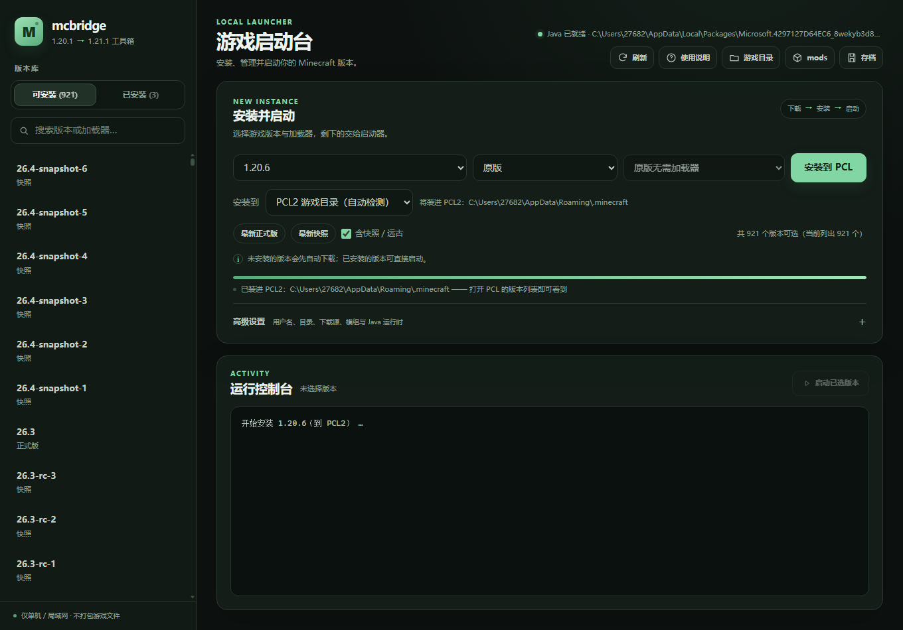

# p227 — 发布包验收：v0.5.10 启动器里的「安装到 PCL2」

日期：2026-10-31。对象不是源码，而是发布资产本身：

- `dist/mcbridge-launcher-0.5.10.zip`
- 11,974,420 B，SHA-256 `4347ae3f7713a650432be2d2f49d323f98a8abc4404dd363930c09a5e32547ff`

## 做法

1. 解压 zip，用包内 `python\python.exe bootstrap.py` 起服务（`LAUNCHER_PORT=8772`，不自动开浏览器）；
2. `GET /api/status`、`GET /api/pcl`；
3. 用 Edge 无头 + CDP 驱动**发布包里的网页**：选 `1.20.6`、`原版`、安装位置切到
   `PCL2 游戏目录（自动检测）`，点「安装到 PCL」，等状态文字变化；
4. 截图 + 写 JSON。

## 结果

```text
api/status root: C:\Users\27682\AppData\Roaming\.minecraft
api/pcl: {"dir": "C:\\Users\\27682\\AppData\\Roaming\\.minecraft", "notes": []}
ui:  target=pcl, hint=将装进 PCL2：…\.minecraft, button=安装到 PCL,
     msg=已装进 PCL2：…\.minecraft —— 打开 PCL 的版本列表即可看到
```



- 发布包能自己定位 PCL2 目录（不是 `%APPDATA%` 兜底，`notes` 为空表示走的是真实配置/快捷方式路径）；
- 点击路径在**打包版**上同样成立，不只是在源码里；
- 装完不在本地启动，提示去 PCL 版本列表。

## 边界

- 同一台机器、真实 `%APPDATA%`（检测要读 PCL 配置）；没有第二台机器；
- 只验 `vanilla 1.20.6`（已装过，安装很快），没有重下大版本；
- 只验「安装到 PCL2」；启动游戏仍由 PCL 负责。

## 文件

- `drive.py`：可复现脚本（解压 → 起服务 → CDP 点击 → 截图）；
- `packaged-result.json`：API 与 UI 的原始返回值。
