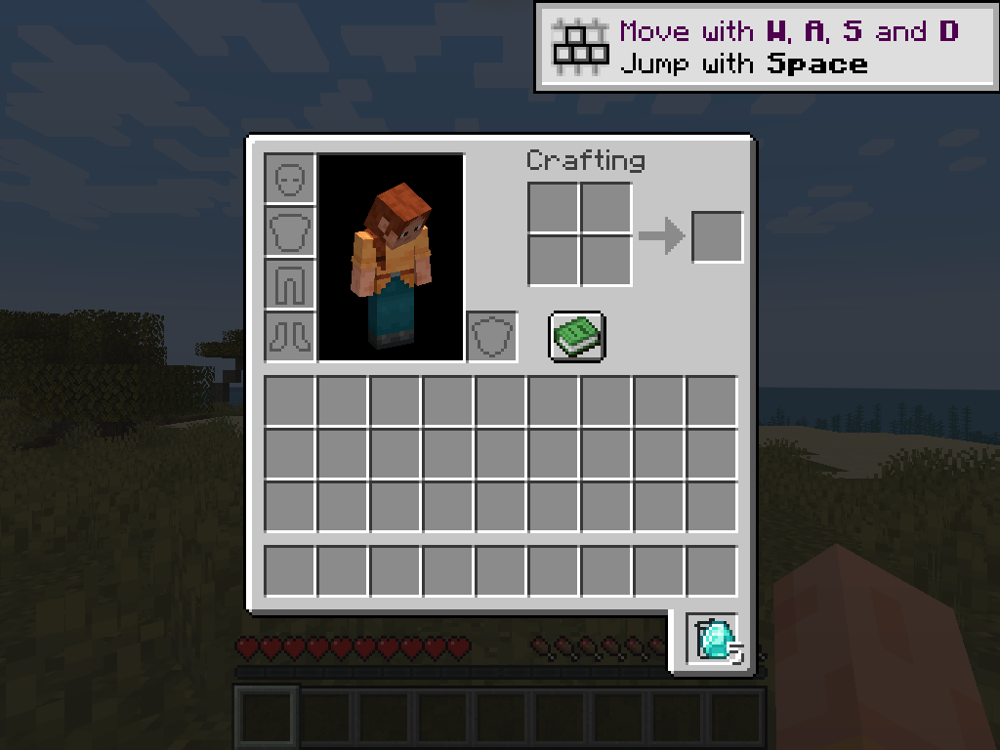

# P61: clean GUI return attempt — second trash click still does not return

Date: 2026-10-19 (Asia/Shanghai). One real 5-diamond stack, no artificial seeding.

## Sequence

1. quick-play into `New World`;
2. probe gives exactly one 5-diamond stack and opens the inventory;
3. click the diamond stack (`305,610` physical);
4. click the trash icon (`743,687`) — 5 diamonds enter the trash;
5. wait 2 s, click the same trash icon again;
6. screenshot.

## Result

The trash still contains the 5 diamonds and the inventory/hotbar are empty:

There is no duplication in this clean run, but the second click did not trigger
`undeleteLast`. This matches P59's earlier second-click result and is now reproduced with a clean
single stack.

## What is already proven separately

- move-in (GUI) + server content: P59;
- `undeleteLast` logic + packet + server clear: P60 (direct provider call);
- `Screen.method_25402(243,219)` did **not** trigger it: P60 diagnostic.

So the remaining fault is specifically the **real mouse second-click path** in the TrashSlot GUI
handler, not the return implementation.

## Not verified

- why the second real click is ignored (event state/hit area/handler gating);
- right-click return;
- empty-trash;
- ironchests GUI / clientbound / two-client sync.

## Evidence

- `after-return.png`, `latest.log`, `client.log`
